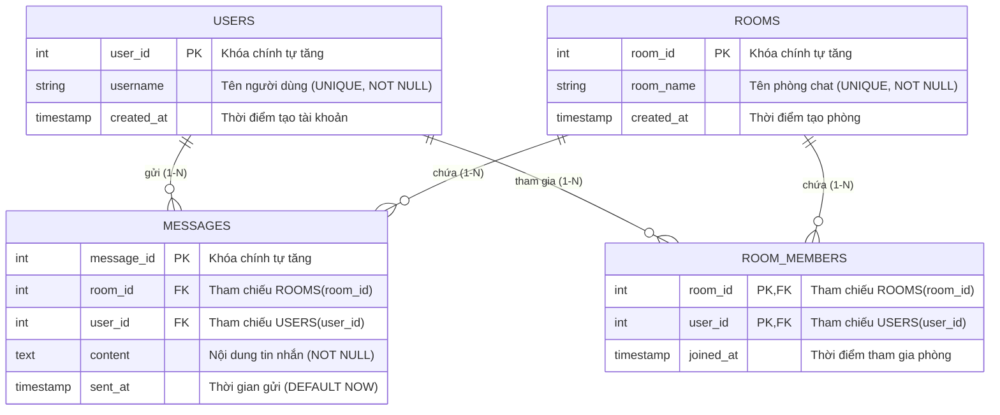

## Mô tả các mối quan hệ
- User - Message (1-N): Một người có thể gửi nhiều tin nhắn
- Room - Message (1-N): Một phòng có thể chứa nhiều tin nhắn của nhiều người
- User - Room (N-M): Một người có thể tham gia nhiều phòng và một phòng có thể chứa nhiều người

### 1. Sơ đồ thực thể - mỗi quan hệ của ba thực thể cốt lõi

### 2. Chuẩn hóa theo 3NF

* Chuẩn 1:
  - Dữ liệu trong các cột là nguyên tử, không cột nào chứa danh sách hoặc mảng
  - Các bảng đều có khóa chính
* Chuẩn 2:
  - Bảng `room_members` có khóa chính kết hợp gồm `(room_id, user_id)`. Thuộc tính `joined_at` phụ thuộc vào cả 2 khóa (thời điểm người dùng này vào phòng này).
  - Các thông tin riêng như `username` hay `room_name` không được để ở bảng này mà đã tách riêng về bảng `users` và `rooms`.
* Chuẩn 3:
  - Trong bảng `messages`, chỉ lưu khóa ngoại `user_id` và `room_id`.
  - Không lưu `username` vào `messages` (vì `username` phụ thuộc vào `user_id`, nếu để ở đây sẽ sinh ra phụ thuộc: `message_id -> user_id -> username`).
### 3. Tập lệnh SQL
```sql
PRAGMA foreign_keys = ON;

CREATE TABLE users (
    user_id INTEGER PRIMARY KEY AUTOINCREMENT,
    username VARCHAR(50) NOT NULL UNIQUE,
    created_at TIMESTAMP DEFAULT CURRENT_TIMESTAMP
);

CREATE TABLE rooms (
    room_id INTEGER PRIMARY KEY AUTOINCREMENT,
    room_name VARCHAR(100) NOT NULL UNIQUE,
    created_at TIMESTAMP DEFAULT CURRENT_TIMESTAMP
);

CREATE TABLE room_members (
    room_id INTEGER NOT NULL,
    user_id INTEGER NOT NULL,
    joined_at TIMESTAMP DEFAULT CURRENT_TIMESTAMP,
    PRIMARY KEY (room_id, user_id),
    FOREIGN KEY (room_id) REFERENCES rooms(room_id) ON DELETE CASCADE,
    FOREIGN KEY (user_id) REFERENCES users(user_id) ON DELETE CASCADE
);

CREATE TABLE messages (
    message_id INTEGER PRIMARY KEY AUTOINCREMENT,
    room_id INTEGER NOT NULL,
    user_id INTEGER NOT NULL,
    content TEXT NOT NULL,
    sent_at TIMESTAMP DEFAULT CURRENT_TIMESTAMP,
    FOREIGN KEY (room_id) REFERENCES rooms(room_id) ON DELETE CASCADE,
    FOREIGN KEY (user_id) REFERENCES users(user_id) ON DELETE CASCADE
);
```
